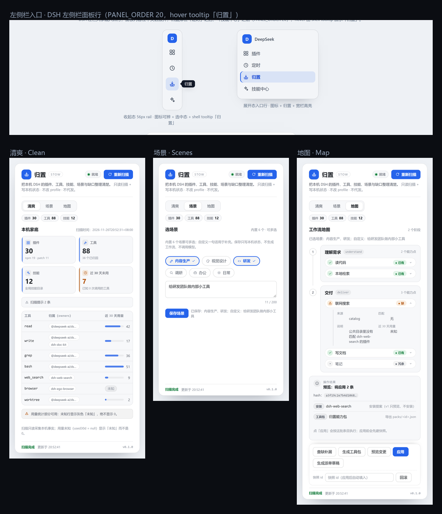
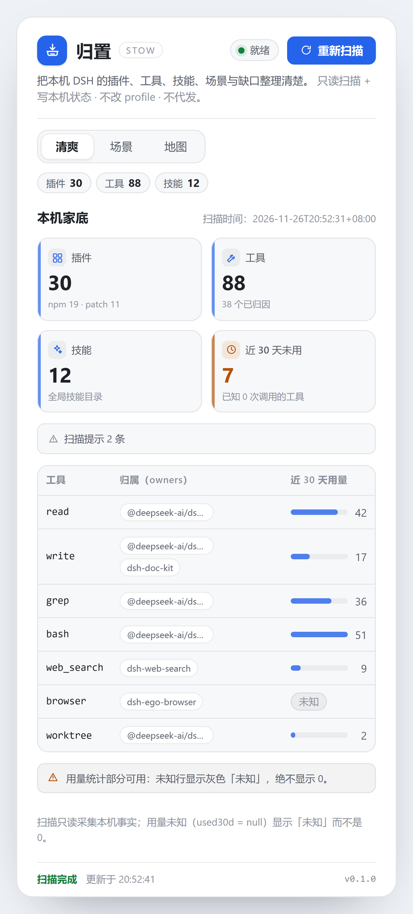
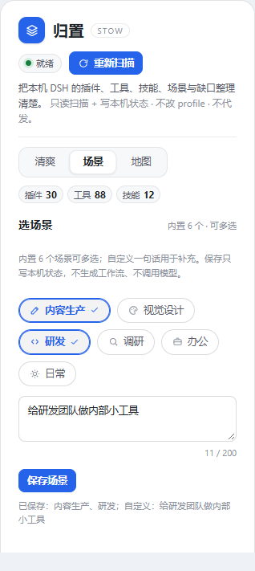
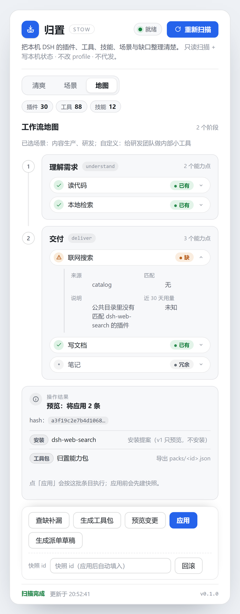

<p align="center">
  
</p>

<h1 align="center">归置 · Stow</h1>

<p align="center"><b>看清你装了什么，按你的工作流归置成可交接的装配清单与软派单载荷。</b></p>

<p align="center">
  <a href="https://github.com/fanyingnie2163663/dsh-guizhi/actions"></a>
  
  
  
  
</p>

<p align="center">
  <a href="#参与与支持">参与与支持</a> ·
  <a href="#它解决什么">它解决什么</a> ·
  <a href="#效率口径质量调整效率">效率口径</a> ·
  <a href="#三屏面板">三屏面板</a> ·
  <a href="#安装">安装</a> ·
  <a href="#快速开始">快速开始</a> ·
  <a href="#数据与隐私">数据与隐私</a> ·
  <a href="#开发">开发</a>
</p>

---

**归置（Stow）** 是一个 [DeepSeek Harness（DSH）](https://github.com/deepseek-ai) 插件：只读盘点本机已装的 **插件 / 技能 / 工具** 与近 30 天用量，按你的工作流拆成阶段、标出**缺口与冗余**，整理成**可交接的装配清单**（一份 JSON 声明：阶段 / 工具 / 技能 / 建议）与**软派单载荷**，减少重复、冲突与无关能力干扰，提高任务质量与一致性。它**不以 token 成本为卖点**：当前工具可见量不变，也不承诺 token 成本下降（口径见 [效率口径：质量调整效率](#效率口径质量调整效率)）。应用时默认只导出装配清单（`packs/<id>.json`）；只有显式勾选「应用时安装工作流技能」才会额外把它编译成工作流技能（`$DSH_HOME/skills/stow-<id>/SKILL.md`，frontmatter 默认 `disable-model-invocation: true`）。v1 的装配清单与派单仍是**声明 + 软约束**：不安装插件、不改 profile；S3 起可实验性派发 worker 并回传**工具面诊断**，但真机实测 restrict 调用成功而 worker 实际可见工具仍为 **67/67**（未缩减），因此 v1 **不承诺工具面隔离、不承诺严格 N 个工具、不承诺 token 成本下降**。任何写操作都先预览、写快照、可回滚。它不改你的预设、不做团队编排、不做插件市场。

> 工欲善其事，必先利其器。—— 先归置，再开工。

## 参与与支持

- **欢迎 PR**：bug 修复、文档修正、新的场景与公共目录源，以及 [状态与已知限制](#状态与已知限制) 里 v1.1 backlog 的任何一项都欢迎。较大的改动建议先开 issue 对一下方向；提交前跑一遍 `node --test test/*.test.js`（492 个测试），保持全绿。
- **点个 Star**：如果归置帮你理清了插件、工具和技能，欢迎给 [fanyingnie2163663/dsh-guizhi](https://github.com/fanyingnie2163663/dsh-guizhi) 点个 ⭐。对这类小工具来说，star 是「继续维护」最直接的信号，也能让更多需要它的人发现它。
- **反馈问题**：用 [GitHub Issues](https://github.com/fanyingnie2163663/dsh-guizhi/issues) 提，附上 DSH 版本、`node -v`、复现步骤和截图更好；真机验收清单见 [`docs/DEMO.md`](docs/DEMO.md) §4。

## 三屏面板



**入口**：DSH 左侧栏面板列表里的「归置」行（排在「定时」之后、「技能中心」之前，`PANEL_ORDER 20`；hover 由 shell 显示「归置」tooltip）——产品记忆点落在左栏；点击后三屏内容在中央区展开。

| 清爽 | 场景 | 地图 |
|:---:|:---:|:---:|
| 家底：插件 / 工具 / 技能 / 近 30 天未用 + 工具表（归属、用量、最后使用）；未知用量显示「未知」，绝不写成 0。 | 6 个内置场景多选 + 一句自定义，保存为工作流选择。 | 阶段卡片 + 能力点（绿=已有、琥珀=缺、灰=冗余），点开先看「精简建议」再看证据；底部查缺补漏 / 生成装配清单 / 预览 / 应用（默认只导出装配清单；勾选「应用时安装工作流技能」才写技能目录）/ 回滚。 |

<details>
<summary>单独看三屏大图</summary>

| 清爽 | 场景 | 地图 |
|:---:|:---:|:---:|
|  |  |  |

</details>

> 无 DSH 也可先看纯静态视觉预览：[`docs/ui-preview.html`](docs/ui-preview.html)（示例数据，非真实面板）。

> **技能清单来源（本轮修复）**：`stow_scan` / `stow_status` 的技能清单 = 宿主 `skills.list` 结果 **+ 磁盘技能根补扫**（`$DSH_HOME/skills`、`~/.agents/skills`，以及有项目上下文时的项目 `.dsh/skills` / `.agents/skills`）。host 行优先，磁盘行只补 host 未报的名字（按 name 去重；磁盘行的 source 标记为 `user-dsh` / `user-agents` / `project-dsh` / `project-agents`）。所以刚写进磁盘技能根的新技能，归置的扫描能看到，不必等宿主缓存刷新；但 **DSH 自身的技能目录 / 模型可见性仍是宿主行为**：技能要进入模型技能目录，通常仍需新会话 / 重启（或按技能 frontmatter 的 invocation 策略），归置不承诺「装完立刻进模型目录」。

## 它解决什么

| 你遇到的问题 | 归置的回答 |
|---|---|
| 装了很多插件，不知道谁带来了哪个工具、哪些从没用过、哪些重复。 | **清爽页**一次盘点：工具 → 归属插件、近 30 天调用次数、最后使用时间；未知就写未知。 |
| 知道缺什么，但不知道按当前工作流该怎么组合。 | **场景 → 地图**：6 个内置场景拆成阶段，每个阶段挂能力点并带证据。 |
| 想调整，怕改坏。 | **提案 → 预览 → 应用 → 回滚**：先出 diff 与稳定 hash；应用先写快照、备份被覆盖文件、记台账；回滚幂等。 |
| 担心装配清单「装进来」改坏环境？ | **写入只有两样，且技能安装是 opt-in**：应用默认只导出 `packs/<id>.json`；只有勾选「应用时安装工作流技能」才写 `$DSH_HOME/skills/stow-<id>/SKILL.md`（可回滚）。不安装插件、不写 profile、不改预设；普通派单是软约束（worker prompt 会写「只用清单工具」，但真机实测它不改变实际可见工具）；应用前先预览，写入前先快照，回滚幂等。 |
| 装配清单只能看、不能用？ | **装配清单 + 可选工作流技能**：勾选安装后，把工作流阶段 / 能力点、建议工具与技能、执行步骤与验收清单编译成 `$DSH_HOME/skills/stow-<id>/SKILL.md`；frontmatter 默认 `disable-model-invocation: true`，不占模型技能目录、可手改后让模型自动调用。它仍是建议式说明书，不改变工具可见性；需要派发时只有实验性 worker 派发（工具面诊断，不保证生效）。 |
| 派单草稿只能泛泛说一句？ | **按装配清单派单**：`stow_draft` 可选 `packId`，生成「只用这些工具 / 技能」的父→子结构化软载荷（阶段 / 能力点、建议工具 / 技能、执行步骤、验收清单）。它只是文本软约束：不删工具 schema、不改变 worker 实际可见工具；S3 的 worker 派发只做工具面诊断（真机实测 restrict 未缩减可见工具）。 |
| 地图标出了冗余，但不知道该精简哪一个。 | **精简建议**：地图里的冗余能力点展开后先看建议（地图可写 `capability.suggestion`；旧地图按证据与扫描用量自动归纳）；只给建议，不自动停用/卸载任何东西。 |
| 外部目录不可靠。 | 目录源 **schema 校验 + 缓存 + fail-open**：不可达/格式错会明确报错，绝不显示成「没有缺口」。 |

## 效率口径：质量调整效率

归置不把「少用 token」当产品目标，而看**质量调整后的效率**：把成功率与质量放进分母，省下的返工、干扰与人工时间也算收益。

- **定义**：每个成功任务的综合成本 = (token + 人工时间 + 返工) / 成功率。成功率上升、返工与无关干扰下降、交接成本降低，都是效率提升；质量提升本身就是效率。
- **不承诺 token 下降**：当前工具可见量不变，归置不缩减工具面，也不承诺节省 token；token 只是度量里的一项，不是卖点。

| 场景 | 用归置的收益 | 不用的代价 / 归置自身的成本 |
|---|---|---|
| 盘点 | 一次看清插件 / 工具 / 技能与近 30 天用量，未知写未知 | 靠记忆猜谁带来了哪个工具；归置需要定期重扫 |
| 冲突与冗余 | 标出重复 / 冗余能力点并给精简建议（只建议、不执行） | 同类工具叠加，误用与选择成本上升 |
| 工作流一致性 | 场景 → 阶段地图 → 装配清单，团队按同一份清单协作 | 每次口头约定，执行口径漂移 |
| 交接 | 装配清单是可读 JSON，可导出、可审阅、可回滚 | 上下文在人脑里，换人 / 换会话就重来 |
| 软派单 | 按清单生成父→子派单载荷，减少无关能力干扰 | 派单靠一句话，范围漂移；归置需要先维护地图与清单 |
| token | 当前工具可见量不变，不承诺节省 | 归置自身也有维护成本（建地图、更新清单） |

- **成功度量建议（需 A/B 实测，不伪造数字）**：成功率、返工轮数、工具误用 / 越界次数、人工交接时间、token 消耗。在真实任务上对比「用 / 不用归置」两组，记录样本量与任务类型；任何未测数字都不写成结论。

## 架构

```text
┌────────────── DSH Web GUI ──────────────┐
│  侧栏「归置」面板（client.js，三屏）      │
│      │ fetch api/guizhi/*  每 3s 轮询     │
└──────┼──────────────────────────────────┘
       ▼
┌────────────── 宿主插件（lib/index.js） ──┐
│  HTTP 路由 /api/guizhi/*                 │
│  10 个 agent 工具 stow_*（含 stow_dispatch）│
│  ┌ lib/routes.js ─ 薄壳与校验/I-O 边界 ┐  │
│  │ scan · usage · scenarios · map      │  │
│  │ catalog · packs · preview/apply     │  │
│  │ attribution · store · schemas       │  │
│  └─────────────────────────────────────┘  │
│  数据根 $DSH_HOME/guizhi/（JSON + 快照）  │
└───────────────────────────────────────────┘
```

纯 ESM、无构建步骤、无运行时框架；插件自身**不调用模型 API**，AI 只在会话里由 agent 调 `stow_*` 工具参与。

## 安装

要求：DSH Desktop `≥ 0.2.2`（开发基线 `0.2.2-rc.5`）、Node `≥ 24.9`。

npm：<https://www.npmjs.com/package/@fanyingnie/dsh-guizhi>（当前 `0.1.0`，仍属 0.x 早期版本，接口与界面可能变化）。

<details>
<summary><b>方式一：GUI（推荐）</b></summary>

1. 打开 DSH 的插件页，选择「从本地安装」，指向本仓库目录（或发布后的 npm 包名）。
2. 重启 DSH（插件行与客户端面板在启动时加载）。
3. 侧栏出现「归置」行，点开即三屏面板。
</details>

<details>
<summary><b>方式二：CLI</b></summary>

```bash
dsh plugin --profile <profile> add /path/to/dsh-guizhi
# 或发布后：
dsh plugin --profile <profile> add @fanyingnie/dsh-guizhi
```

> 插件改动只对**下一个会话 / 重启后**生效。
</details>

<details>
<summary><b>方式三：手动编辑 profile（无 CLI 时）</b></summary>

1. 将本仓库 `cordis.patch.yml` 的 insert 行合并进 `$DSH_HOME/profiles/<profile>/cordis.patch.yml`；
2. 在该 profile 的 `package.json` 的 `dependencies` 与 `dsh.profile.bundles` 中加入本包；
3. 在 profile 目录执行 `pnpm install`，然后重启 DSH。

完整手动步骤与验证判据见 [`docs/DEMO.md`](docs/DEMO.md) §4 与 [`docs/host-notes.md`](docs/host-notes.md) §8。
</details>

## 快速开始

1. **清爽**页点「重新扫描」：只读盘点本机，不调模型。
2. **场景**页选场景 + 写一句自定义，保存。
3. 让会话 agent 用 `stow_map_save` 把工作流落成阶段地图（阶段 + 能力点 + 证据）；冗余能力点建议让 agent 写 `capability.suggestion`（精简建议），没写时面板会按证据与扫描用量自动归纳。
4. **工作流**页先在「目录源」填一个 format-1 目录地址并保存（推荐源见下节），再点「查缺补漏」：从该目录匹配缺口（不可达会明确报错）。
5. 点「生成装配清单」：只生成 `kind=pack` **提案**（装配清单），不落盘；如果清单里没有任何工具 / 技能，结果区会**告警**（空清单不伪装成可应用内容）。
6. 点「预览变更」：看 diff 与稳定 hash，确认要应用的条目。
7. 点「应用」：默认**只导出**装配清单 `packs/<id>.json`（先写快照、备份会被覆盖的旧包、记台账）。只有先勾选操作区的「应用时安装工作流技能（写入 $DSH_HOME/skills，默认不装，可回滚）」，才会额外把非空清单安装为 `$DSH_HOME/skills/stow-<id>/SKILL.md`（可回滚；真机探针（修复前）：当前会话技能列表未刷新；已加入 skills.invalidateCache() 刷新修复，待重启复验）。
8. 点「回滚」：删除本次新建的包；若勾选安装过技能，一并删除本次新建的技能文件 / 恢复被覆盖的旧 `SKILL.md`；恢复状态，重复回滚幂等。
9. 点「生成派单草稿」：生成装配清单成功后，面板会记住最近一次 pack id，草稿改为按该清单生成父→子结构化软载荷（无 pack id 时仍是旧的扫描草稿）；草稿只是文本，面板不会代发。
10. 点「派发 worker（实验性）」：按最近一次装配清单派发 worker（与 `stow_dispatch` 同一实现）；结果卡展示 worker 会话 id、`toolFaceApplied`（只说明 restrict 被调用）、请求限制工具数与 warnings，以及宿主回传的 `toolFace.report`（`report.visible` 列出 restrict 后实际可见工具，前 12 个 + 总数、allowed/skipped/leaked 计数；report 为 null 时按 warnings 说明、不伪造列表）。**真机实测（DSH 0.2.2-rc.5）：restrict 调用成功但可见工具仍为 67/67（未缩减），因此 v1 不承诺隔离 worker 工具面、不承诺严格 N 个工具、也不承诺 token 成本下降**；验收以 worker 实际工具列表 / `report.visible` 为准，而不是只看 `toolFaceApplied`。

> **「一键整理」只到预览**：自动扫描 → 查缺补漏 → 生成装配清单（全部阶段）→ 预览；它**不会替用户应用**：不写 `packs/` 文件、也不安装技能，确认后仍需自己点「应用」（应用时默认只导出装配清单；勾选安装技能才会写技能目录）。空清单同样会告警。
>
> **v1 的装配清单产物是「JSON 声明 + 可选工作流技能」**：应用默认只导出 `packs/<id>.json`；技能安装是 **opt-in**，勾选后才写 `$DSH_HOME/skills/stow-<id>/SKILL.md`（可回滚）；不安装插件、不改 profile、也不改变工具可见性；「派单草稿」同样只是文本建议。S3 新增实验性 worker 派发：把清单工具名作为 allowlist 调一次 `restrict` 并回传工具面诊断（`toolFace.report.visible` / `leaked`），真机实测 restrict 未改变 worker 可见工具（67/67），不承诺隔离 / 严格 N / token 成本下降。
>
> **技能默认不自动进入模型技能目录**：生成的 `SKILL.md` frontmatter 默认带 `disable-model-invocation: true`（不占模型技能目录；可手改后让模型自动调用）。技能目录 `$DSH_HOME/skills` 是全局目录，有可见范围；项目级 `.dsh/skills` 是后续方向。


### 目录源（查缺补漏用）

查缺补漏需要一个**公共目录**（format-1 JSON 索引）来匹配本机缺失的能力。目录源不内置默认值：外部内容默认不可信，请自己确认来源后填入。

**在面板里填**：工作流页 →「目录源」输入框 → 粘贴 http(s) 地址 →「保存」。配置写入 `$DSH_HOME/guizhi/sources.json`；随后「查缺补漏」或「一键整理」就会使用它（结果缓存 6 小时；不可达/格式错会明确报错并 fail-open，不会显示成「没有缺口」）。

**面板里的推荐源**：输入框上方有一排推荐源胶囊（dshopen、jsDelivr 精选）。点一下只会把地址**填入输入框**——不自动保存，也不会主动发起请求；确认来源后自己点「保存」才生效。推荐源均为第三方目录、非官方，是否信任由你决定。

**推荐源**（2026-11-27 联网核对了前三个可访问源的返回形状；外部目录随时可能变化，填入后点一次「查缺补漏」即可确认能否解析）：

| 源 | 地址 | 实测（2026-11-27，本机） | 说明 |
|---|---|---|---|
| dshopen 开放插件市场 | `https://dshopen.org/index.json` | 2.8s · 2.4MB · 缓存 594KB（在 1MB 内） | 社区维护的独立索引；`title` 为 `{en,zh}` 本地化对象；**面板推荐源之一** |
| Awesome DSH Plugin（jsDelivr） | `https://cdn.jsdelivr.net/npm/dsh-plugin-catalog/index.json` | 6.9s · 5.7MB · 缓存 3.2MB（超 1MB 上限，会每次重拉） | 社区精选列表的 format-1 索引，npm/CDN 分发；DSH 0.2.1+ 的「插件 → 发现 → 索引源」也用它；**面板推荐源之一** |
| Awesome DSH Plugin（源站） | `https://awesome-dsh-plugin.com/index.json` | 浏览器通道可访问；node 直连 >20s 超时 | 同一份目录的 GitHub Pages 源站；部分网络很慢 |
| dsh-market 镜像 | `https://dshmarket.com/index.json` | 超时，未确认 | 同一份目录的镜像；本次未核验通过 |
| 自托管示例 | 把 [`docs/catalog.example.json`](docs/catalog.example.json) 放到任意 HTTPS 静态地址 | 取决于托管位置 | 纯字符串字段的简化示例，插件条目请按你的真实来源替换 |

> 自托管示例的 raw 地址形如 `https://raw.githubusercontent.com/<你的 GitHub 账号>/dsh-guizhi/v1/docs/catalog.example.json`（需对应分支已推送）。目录源不内置默认值：外部内容默认不可信，选哪个由你决定。
>
> 设计的可选增强源 **dsh.so**（Plugin Record / 验证等级 / 下载量 / agent skill）不在 v1 范围，留待 v1.1；上表只列 v1 能直接消费的 format-1 索引。

**目录格式（format-1）**：根对象含 `plugins` 数组；每条至少 `name`，可选 `title` / `description` / `version`。`title` / `description` 可以是字符串，也可以是 `{ en, zh }` 语言文案对象（真实公共索引多为后者；标题按 `zh` → `en` 取一个，描述拼接所有语言用于匹配）。查缺补漏会用能力点 id/标题与条目的 name/title/description 做包含匹配（单向），已安装的插件名会跳过，最多生成 20 条安装提案。

```json
{
  "format": 1,
  "plugins": [
    { "name": "@example/dsh-web-research", "title": "网页调研", "description": "实时网页浏览与检索、页面结构抽取" },
    { "name": "dsh-plan-note", "title": { "zh": "计划批注", "en": "Plan notes" }, "description": { "zh": "给计划加批注", "en": "Inline annotations" } }
  ]
}
```

- 只接受 `http(s)` 地址；目录内容只解析为数据，不执行、不自动安装；磁盘缓存 6 小时。
- 源不可达或格式不符会 fail-open：返回空结果 + 明确 `error`，绝不显示成「你没有缺口」。
- 想要一份更完整的清单，可以按 format-1 自己维护并托管（gist / 静态站点 / 内部服务均可）。
### Agent 工具（10 个 `stow_*`）

| 工具 | 作用 |
|---|---|
| `stow_scan` | 只读扫描插件 / 技能 / 工具与近 30 天用量 |
| `stow_status` | 状态汇总（家底、用量是否未知、最近扫描） |
| `stow_map_save` | 保存工作流地图（阶段 / 能力点 / 证据；冗余能力点可带 `suggestion` 精简建议） |
| `stow_pack_build` | 由地图阶段生成装配清单提案（stage 声明与能力点 evidence 派生工具 / 技能；空清单会告警） |
| `stow_gaps` | 目录匹配缺口并生成提案 |
| `stow_preview` | 预览要应用的变更与 hash |
| `stow_apply` | 应用（先快照，默认只导出装配清单 `packs/<id>.json`；`installSkill: true` 时才把非空清单安装为工作流技能 `stow-<id>`；v1 不安装插件、不改 profile） |
| `stow_rollback` | 回滚指定快照（含本次安装的技能文件 / 被覆盖的旧技能） |
| `stow_draft` | 生成「这个活只需要 A/B/C」派单草稿（不代发）；可选 `packId` 按装配清单生成父→子软载荷（软约束，不删工具 schema、不改变实际可见工具） |
| `stow_dispatch` | 派发后台执行会话（S3 实验性 worker 派发 + 工具面诊断）：`kind: 'map'` 按场景拆解地图；`kind: 'pack'` + `packId` 按装配清单派发 worker，把清单工具名作为 allowlist 调用 `agent.ctx.tools.restrict({ allow })` 并回传工具面诊断 `toolFace.report`（visible / allowed / skipped / leaked）。真机实测（DSH 0.2.2-rc.5）：restrict 调用成功但 worker 实际可见工具仍为 67/67（未缩减），因此 v1 不承诺隔离 worker 工具面、不承诺严格 N 个工具、不承诺 token 成本下降；worker prompt 的「只用清单工具」是软约束，宿主不支持时降级为纯软约束并返回 warning。请以 `report.visible` 为准而非 `toolFaceApplied`。 |

### HTTP 路由

`GET /api/guizhi/state`（含派生 `advice` 精简建议视图） · `POST /api/guizhi/{scan,scenarios,map,pack,gaps,preview,apply,rollback,draft,dispatch,sources,pipeline}` · `GET /api/guizhi/pipeline/status`（仅本机 loopback，按插件内围栏拒绝远端）。应用 body 为 `{ ids, installSkill? }`（缺省 `false` 只导出装配清单；非布尔 400 `INSTALL_SKILL_INVALID`）；草稿 body 为 `{ kind: 'dispatch', packId? }`（`packId` 非法 / 不存在 400）；派发 body 为 `{ kind: 'map' | 'pack', packId? }`（`kind='pack'` 必填 `packId`；响应含 `toolFaceApplied` / `toolFace`（`report.visible` 为 restrict 后实测可见工具，真机实测 67/67、未缩减；取不到时 null）/ `warnings`；缺 `sessionController` / `sessionQuery` 时 503）。

### 实验性：worker 派发与工具面诊断（S3）

入口：工作流操作区的「派发 worker（实验性）」（需先生成装配清单，按最近一次 pack id 派发），或会话里的第 10 个工具 `stow_dispatch({ kind: 'pack', packId })`；两者与 `POST /api/guizhi/dispatch` 同一实现。

机制：pack 派发先把清单里的工具名作为 allowlist、为 worker 预生成 session id；宿主触发 `agent/created` 后，插件调用 `agent.ctx.tools.restrict({ allow })`，`agent/disposed` 时释放。响应中的 `toolFaceApplied: true` 只表示这次 `restrict` 被调用并返回成功，**不代表 worker 实际只看到 N 个工具**，也不代表工具可见性被改变。

**工具面诊断（不是限制生效的证据）**：pack 派发在 worker 创建后向宿主取一次 restrict 后的工具面，写入响应 `toolFace.report = { sessionId, applied, allowed, skipped, leaked, visible, reason? }`。`visible` 是 restrict 之后 worker 实际可见的工具名（诊断证据，可能仍含 `run_code`、归置自身层 / 宿主豁免工具）；`allowed` / `skipped` / `leaked` 分别是进入 allowlist、宿主未提供、清单外仍可见的工具。1 秒内取不到报告时 `report: null` 并在 warnings 说明——不伪造。

**真机实测（2026-11-28，DSH 0.2.2-rc.5）：`agent.ctx.tools.restrict({ allow })` 调用成功，但 worker 实际可见工具仍为 67/67（未缩减）；`toolFace.report.visible`（67）与 `leaked` 是这一结论的诊断证据。** 因此 v1 **不承诺工具面隔离、不承诺严格 N 个工具、不承诺 token 成本下降**；当前价值在盘点 / 地图 / 装配清单 / 软派单 / 质量与交接，worker 派发只作为实验性入口与诊断工具。worker prompt 要求「即使可见也不要用清单外工具」，这是**软约束**。

降级矩阵：

| 情况 | 行为 |
|---|---|
| 缺 `sessionController` / `sessionQuery` | **503**，不派发（面板按钮禁用并提示） |
| 宿主适配器不支持工具面准备 | 软派单 + `toolFaceApplied: false` + warning |
| 宿主未采用预生成会话 id | 诊断不生效 + warning（计划中的 allowlist 被丢弃） |
| 宿主不回传实测工具面 | `toolFace.report = null` + warning（不伪造可见列表，派单照常） |
| 可限制工具与清单无交集 / `restrict` 不可用 | 软派单 + warning（`toolFace.prepared = false`） |
| 创建 / 投递会话失败 | **502** + 持久化 `state=failed` 记录，可重试 |
| 已有 running 记录 | 409 单飞拒绝 |

**真机状态**：restrict 调用与 `toolFace.report` 回传已在 DSH 0.2.2-rc.5 实测（结果 67/67，未缩减）；面板渲染、worker 是否遵守软约束、录屏仍 not-run。验收方式不是只看 `toolFaceApplied`：看结果卡的 `toolFace.report.visible` / `leaked` 并让 worker 汇报实际工具列表，按实测记录，不要写成「已隔离」「严格 N」或「能降低 token 成本」。

## 数据与隐私

```text
$DSH_HOME/guizhi/
├── scan.json          # 最近一次扫描
├── map.json           # 工作流阶段 / 能力点 / 证据
├── proposals.json     # 缺口与 pack 提案
├── selections.json    # 场景选择
├── packs.json         # /pack 生成时的 pack 内容（保证 preview=apply）
├── sources.json       # 公共目录源配置
├── packs/<id>.json    # apply 后导出的装配清单
└── snapshots/<id>/    # 快照 + packs-created.json / skills-created.json 台账 + packs-backup/ / skills-backup/

$DSH_HOME/skills/stow-<id>/SKILL.md   # 勾选安装技能时 apply 写入（opt-in；rollback 删除或恢复；真机探针（修复前）：当前会话技能列表未刷新（32→32）；已加入 skills.invalidateCache() 刷新修复，待重启复验）
```

- **只读扫描**：不读凭据、不读与插件/技能无关的会话内容；用量只取工具调用名与时间，不上行、不落盘明细。
- **不调模型**：插件自身不调用任何模型 API。
- **写操作可回滚**：任何落盘先写快照、备份会被覆盖的文件（包文件台账 `packs-created.json` / 技能台账 `skills-created.json`）、记台账；回滚幂等。
- **外部目录只当数据**：format-1 索引做 schema 校验、缓存、fail-open；内容不执行、不自动安装。
- **应用 = 默认导出装配清单；技能安装是 opt-in**：默认只写 `packs/<id>.json`；显式 `installSkill: true` 时才写 `$DSH_HOME/skills/stow-<id>/SKILL.md`（frontmatter 默认 `disable-model-invocation: true`，不占模型技能目录；真机探针（修复前）：当前会话技能列表未刷新；已加入 skills.invalidateCache() 刷新修复，待重启复验）。不安装插件、不改 profile、不改预设、也不限制工具面；`install` 类提案只提示不执行（v1.1）。写盘同样先快照、可回滚。

## 开发

```bash
pnpm install                    # 仅 yaml 运行时依赖
node --test test/*.test.js      # 492 个测试
node --check client.js lib/*.js # 语法检查（无构建步骤）
```

```text
lib/           纯函数与 I/O 层（scan / usage / scenarios / map / advice / catalog / packs / apply / routes / store / schemas / host / attribution / http）
client.js      DSH client 插件：三屏面板（无构建步骤，React.createElement）
cordis.patch.yml  插件行
docs/          设计、计划、宿主 API 笔记、演示脚本、UI 静态预览
test/          node:test：单元 + 路由 + HTTP 适配 + e2e
```

## 状态与已知限制

- **v0.1 功能已实现**：492/492 测试通过（含 S2「技能安装 opt-in」「按 pack 生成派单草稿」与 S3 实验性「worker 派发 + 工具面诊断」；S1–S3 改动已实现（本轮提交）；npm `0.1.0` 为 0.x 早期版本）。
- **冗余精简建议（v1.1 先行项）**：`capability.suggestion` 可选字段 + `GET /api/guizhi/state.advice` 派生视图；地图没写建议时按证据与扫描用量自动归纳（用量未知不写成 0，0 次不代表无用），只建议、不自动停用/卸载任何东西。
- **「装配清单」v1 的真实能力**：`packs/<id>.json` 是 JSON 声明（阶段 / 工具 / 技能 / 建议）；**v1 的 pack 仍是声明 + 软派单**，应用默认只导出它。**技能安装是 opt-in（S2）**：勾选后才会把非空清单编译成 `$DSH_HOME/skills/stow-<id>/SKILL.md`（含工作流阶段 / 能力点、建议工具与技能、执行步骤与验收清单；frontmatter 默认 `disable-model-invocation: true`，不占模型技能目录、可手改后让模型自动调用；可回滚）。**不安装插件、不改 profile、不改变工具可见性**；「一键整理」到预览即止，不会替用户应用。真机检测（修复前）：写入后当前会话技能列表未刷新（32→32）；已加入 skills.invalidateCache() 刷新修复（待重启复验）。S3 的 worker 派发会调用 restrict 并回传工具面诊断，真机实测可见工具未缩减（67/67），不承诺隔离 / 严格 N / token 收益。
- **按 pack 生成派单草稿（S2）**：`stow_draft` 可选 `packId`；有值时从 `packs` 状态生成父→子结构化软载荷（标题、阶段 / 能力点、建议工具 / 技能、执行步骤、验收清单，固定句说明「只使用上述工具/技能；这是软约束」）。它只是文本：不删工具 schema、不改变 worker 实际可见工具；S3 的 worker 派发会调用 restrict 并回传工具面诊断，真机实测未改变可见工具（67/67），不承诺隔离 / 严格 N / token 收益。
- **真机检测（2026-11-28，DSH 0.2.2-rc.5）**：插件与 10 个 `stow_*` 工具加载；S1 pack 从 evidence 派生 42 工具 / 27 技能 / 27 行；pipeline 4 步到预览；S2 默认只导出、opt-in 安装/回滚文件正确；S3 派单完成（空清单降级软约束）。**发现并修复**：①插件 Node fs 写技能后 DSH skills 列表不刷新（apply/rollback 现在调用 `skills.invalidateCache()`，响应含 `skillsRefreshed`）；②空 pack dispatch 误报 `toolFaceApplied:true`；③map dispatch 可能复用 pack worker 会话。**本轮修复（待重启复验）**：④技能清单滞后（宿主 `skills.list` 缓存）：`listSkills` 现在合并磁盘技能根补扫（host 优先、按 name 去重）；⑤S3 响应新增 `toolFace.report.visible` 实测字段（restrict 后实际可见工具；取不到时 null + warning，不伪造）。**S3 工具面真机实测（本轮）**：restrict 调用成功，但 worker 实际可见工具仍为 67/67（未缩减，report.visible / leaked 为诊断证据）——因此 v1 不承诺隔离 worker 工具面、不承诺严格 N 个工具、不承诺 token 成本下降。修复需重启后复验；面板 GUI、worker 是否遵守软约束、token 变化仍 not-run。
- **空清单会告警**：地图与能力点 evidence 都派生不出工具 / 技能时，`/pack` 与「一键整理」都会在结果区给出 warnings，不把空清单当成可应用内容。
- **真机验证仍待执行（not-run）**：面板渲染、路由可达、10 工具真实注册调用、**worker 实际工具面与软约束遵守（restrict 已真机实测未缩减可见工具 67/67；面板展示与 worker 行为仍 not-run）**、**技能安装后重启/新会话可见性（宿主 refresh 修复 + 磁盘补扫待重启复验；`stow_scan` 侧已能补扫到磁盘技能）**、录屏、用户测试 —— 步骤见 [`docs/DEMO.md`](docs/DEMO.md) §4；本 README 不宣称真机通过。
- **v1.1 / next 计划（均未实现，不是 v1 现状）**：插件行安装与「需要新会话/重启」提示、能力点「生效方式/需单开会话」徽章、工具可见性控制（v-next；当前宿主 restrict 未缩减可见工具，v1 只做诊断）、项目级 `.dsh/skills`、清爽页重复/冲突与上下文成本、应用抽屉逐条启用/忽略、冗余**提案**（当前只在地图能力点展开处显示「精简建议」，不生成可应用提案）与来源信任等级、无 client 插件时的 HTML 报告兜底、场景→工作流自动拆解。

## 文档

- 设计：[`docs/superpowers/specs/2026-11-26-guizhi-design.md`](docs/superpowers/specs/2026-11-26-guizhi-design.md)
- 实施计划：内部任务拆解不随仓库分发（以上设计文档为公开参考）。
- 宿主 API 笔记：[`docs/host-notes.md`](docs/host-notes.md)
- 演示与验收：[`docs/DEMO.md`](docs/DEMO.md)
- UI 静态预览：[`docs/ui-preview.html`](docs/ui-preview.html)

## License

MIT © 2026 聂凡瑛（fanyingnie）
